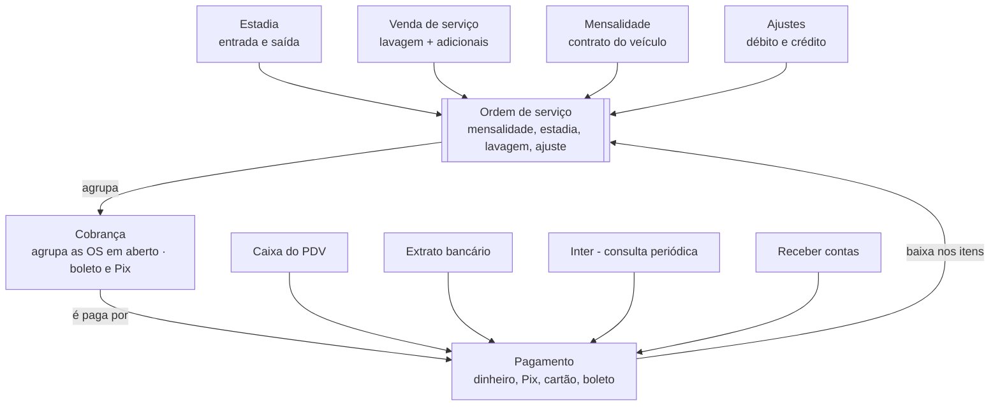

# Modelo de dados

> Parte da documentação do ERP Local. Índice: [docs/README.md](README.md)

O banco passa de 24 tabelas para cerca de 35, organizadas em seis grupos; o centro do dinheiro vira **ordem de serviço → cobrança → pagamento**, em vez de só ordens com data de pagamento.

Todo valor nasce como ordem de serviço, é agrupado numa cobrança e baixado por um pagamento, venha ele do caixa, do extrato, do Inter ou do balcão.

**Regras que valem para todas as tabelas de negócio**

- `empresa_id` em todas; `unidade_id` em tudo que acontece num pátio (ordens de serviço, estadias, caixa, preços, gastos).
- Lançamentos que o PDV cria (estadias, ordens de serviço, pagamentos) usam **UUID** como identificador, para nascer no celular sem conflito; o resto usa número sequencial.
- Dinheiro **nunca é apagado**: ordem de serviço e pagamento são cancelados com motivo, data e usuário.
- Valores em `decimal(10,2)`; datas e horas em `datetime` com fuso de São Paulo.
- Todo registro guarda `criado_por` e `origem` (gestão, PDV, extrato, Inter, cadastro público).

**Veículos sem placa**

- O veículo é identificado pelo id interno, nunca pela placa; placa é opcional.
- Placa, quando existe, não se repete entre veículos ativos da mesma empresa; a comparação ignora traço, espaço e maiúsculas.
- Sem placa (bicicleta elétrica, patinete, autopropelido), o veículo exige uma identificação alternativa: número do quadro ou de série, marca, modelo, cor e foto opcional.
- No avulso do PDV, o ticket (QR Code) identifica o veículo na saída quando não há placa.
- Troca de placa (conversão para Mercosul, placa nova) fica no histórico do mesmo veículo; o formato da placa não é travado, para aceitar placas de outros países.
- Autopropelidos ganham tipo de veículo próprio, com tarifa e preços próprios.

| Grupo | Tabela | O que guarda | Campos principais |
|---|---|---|---|
| Núcleo | empresas | Cada empresa do sistema (hoje só a Local) | nome, documento, logo, configurações (mês comercial, vencimento padrão) |
| Núcleo | unidades | Cada pátio | empresa, nome, endereço |
| Núcleo | usuarios | Quem entra no sistema | nome, login, senha, nível, unidade (vazio = todas), operador de caixa (sim ou não), ativo |
| Núcleo | niveis | Níveis de acesso configuráveis | nome, permissões, fixo (acesso total) |
| Núcleo | aparelhos | Celulares do PDV | unidade, nome, token, último contato |
| Núcleo | log_atividades | Quem fez o quê | usuário, ação, detalhe, IP, quando |
| Clientes | clientes | Mensalistas, conveniados e avulsos identificados | nome, CPF/CNPJ, telefones, e-mail, endereço, dia de vencimento |
| Clientes | veiculos | Veículos (com ou sem cliente) | identificador interno, placa (opcional), identificação alternativa (número do quadro, apelido, foto), tipo, marca, modelo, cor, cliente |
| Clientes | mensalidades_contratos | O plano de cada veículo mensalista | veículo, período (diurno, noturno, 24h), valor, início, fim |
| Clientes | convenios | Regra de cada conveniado | cliente, modo, limite, desconto, vale para estadia ou serviços |
| Clientes | cadastros_pendentes | Fila do cadastro público | dados enviados, consentimento, IP |
| Clientes | pagadores_vinculados | PIX de terceiros ligados a um cliente | nome, documento, conta, cliente |
| Preços | tipos_veiculo | Tipos configuráveis | nome, detalhe |
| Preços | tarifas + faixas + pacotes | Tabelas de cobrança por tempo | unidade, tolerância, fração, faixas, diárias, pernoite |
| Preços | tarifa_tipos | Qual tabela vale para qual tipo | tarifa, tipo, unidade |
| Preços | servicos + servico_adicionais | Lavagens e adicionais | nome, papel (principal ou adicional), detalhe, conta do plano de contas, código de serviço municipal, alíquota de ISS |
| Preços | servico_precos | Preço por tipo de veículo | serviço, tipo, unidade (vazio = preço da empresa), valor |
| Operação | estadias | Ticket: entrada e saída de um veículo | placa, entrada, saída, tarifa, convênio, valor calculado, valor final, situação, aparelho |
| Operação | ordens_servico | Cada ordem de serviço: tudo o que o cliente deve | tipo (mensalidade, estadia, lavagem/serviço, débito, crédito), cliente, veículo, competência, valor, vencimento, estadia, cobrança, quem paga, situação (aberta, paga, cancelada + motivo); em lavagens também etapa (aguardando, lavando, pronta, entregue) e funcionário |
| Financeiro | cobrancas | Agrupa as ordens de serviço em aberto de um cliente ou convênio; gera o boleto | cliente, número, competência, vencimento, total, situação, dados do boleto e Pix |
| Financeiro | pagamentos | Cada dinheiro recebido (ou boleto/Pix emitido aguardando) | cliente, cobrança, forma, valor bruto, taxa, líquido, data prevista, recebido em, conta financeira, caixa, origem, situação (pendente, confirmado, falhou/expirado, estornado) |
| Financeiro | pagamento_itens | Quanto de cada pagamento foi para cada ordem de serviço | pagamento, ordem de serviço, valor |
| Financeiro | caixas + caixa_movimentos | Turno de caixa do PDV | operador, abertura, fechamento, saldo informado, sangrias, suprimentos |
| Financeiro | formas_pagamento | Formas aceitas e condições | nome, tipo, conta de destino, taxa % e fixa (por parcelas no crédito), prazo de recebimento (dias, número livre), ativa |
| Financeiro | extrato_lancamentos | PIX já importados do extrato | identificador, data, valor, pagador, pagamento gerado |
| Gastos | funcionarios | Funcionários (registrados e avulsos) e fornecedores | nome, CPF, vínculo, cargo, combinado (mensal, semanal, diária) |
| Gastos | holerites | Dados lidos do PDF | funcionário, competência, bruto, líquido, FGTS, INSS, arquivo |
| Gastos | despesas | Cada conta a pagar ou paga | fornecedor ou funcionário, categoria, competência, vencimento, parcela, previsto, pago, forma, conta de saída, comprovante |
| Gastos | despesas_recorrentes + categorias | Contas fixas e o plano de contas | modelo, dia, valor previsto; Folha, FGTS, impostos, aluguel, energia |

## Tabelas acrescentadas pelas decisões de 09/11/2026

Ver [12-decisoes.md](12-decisoes.md) e [11-comparativo-mercado.md](11-comparativo-mercado.md).

| Grupo | Tabela | O que guarda |
|---|---|---|
| Financeiro | cobranca_itens | Cópia das ordens de serviço na emissão da cobrança (cobrança imutável); linha "saldo anterior" |
| Financeiro | ajustes | Crédito, débito, estorno e desconto ligados à cobrança ou ao pagamento, com motivo e usuário |
| Financeiro | plano_contas | Árvore de contas de receita e despesa (modelo pronto, editável) |
| Financeiro | centros_custo | Lista cadastrada de centros de custo (ex.: Estacionamento, Lavagem) |
| Financeiro | contas_financeiras | Caixa, bancos, maquininha; saldo |
| Financeiro | movimentos_financeiros | Toda entrada, saída e transferência por conta; base da conciliação |
| Financeiro | notas_fiscais | Notas ligadas à cobrança (estrutura pronta, emissão no futuro) |
| Financeiro | regua_cobranca + avisos_enviados | Etapas da régua e registro de cada aviso (com o WhatsApp) |
| Núcleo | numeracoes | Sequência própria por empresa e tipo de documento (cobrança, OS, ticket) |
| Gastos | fornecedores, cartoes, faturas_cartao | Fornecedores; cartões de crédito da empresa e suas faturas |

**Campos acrescentados**

- Vigência (início e fim) em `servico_precos`, `tarifas` e `mensalidades_contratos`.
- `mensalidades_contratos`: pausa (período e taxa de reserva) e encerramento agendado.
- `pagamentos`: conta financeira, valor bruto, taxa, líquido, data prevista e situação.
- `servicos`: conta do plano de contas, código de serviço municipal e alíquota de ISS.
- `ordens_servico` e `despesas`: centro de custo (opcional) e conta do plano de contas.
- `unidades`: capacidade de vagas por tipo de veículo e vagas reservadas para mensalistas.
- `clientes`: não recebe avisos da régua.
